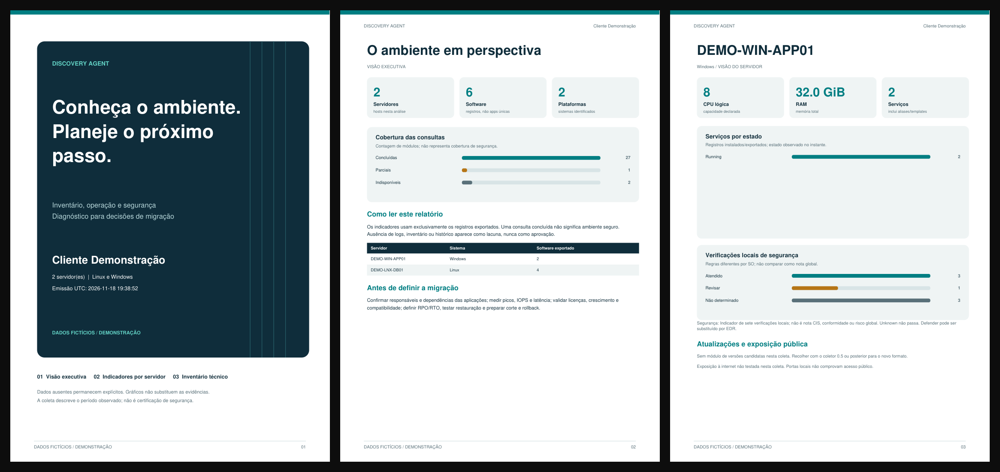
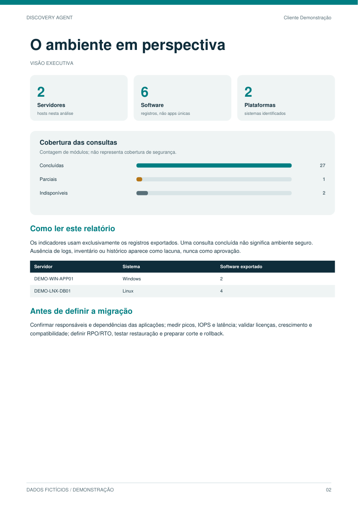
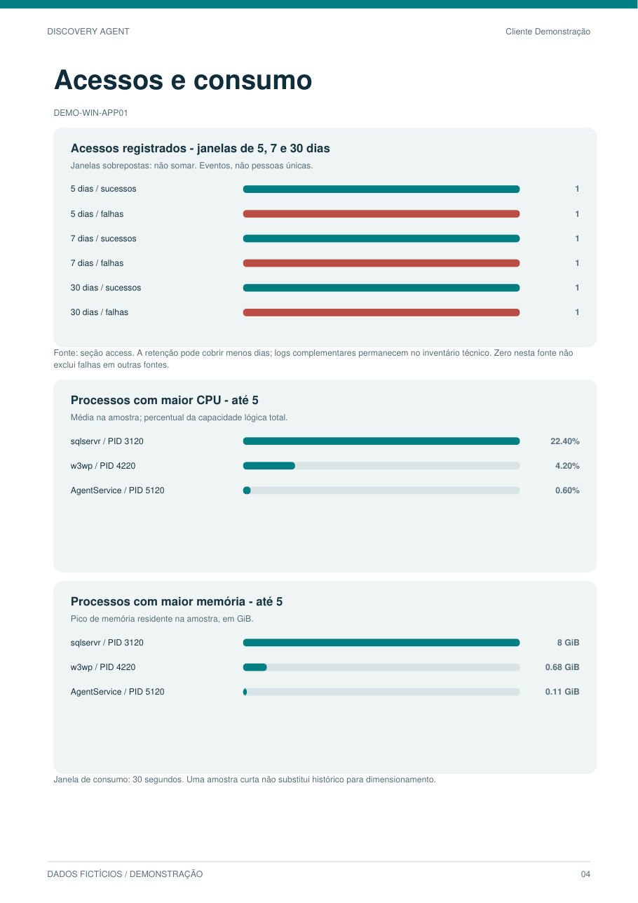
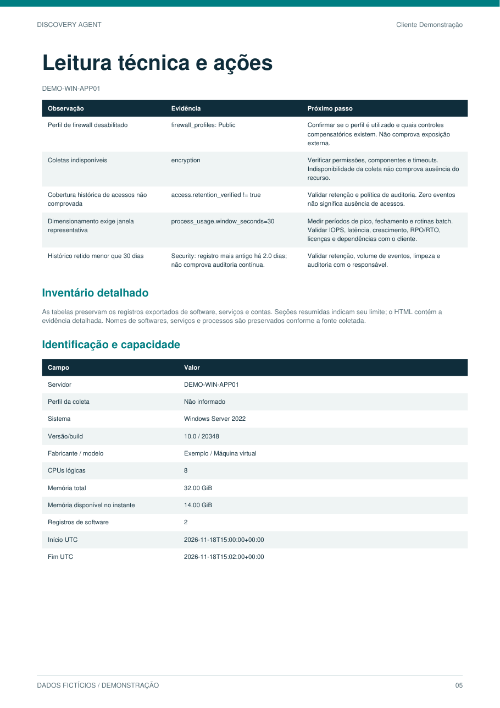
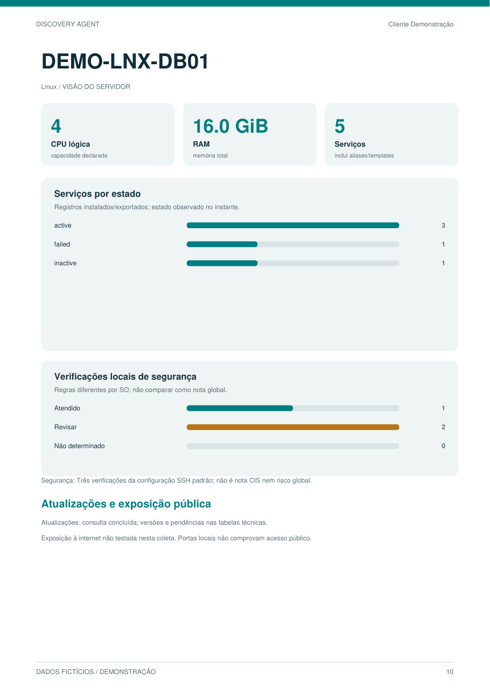
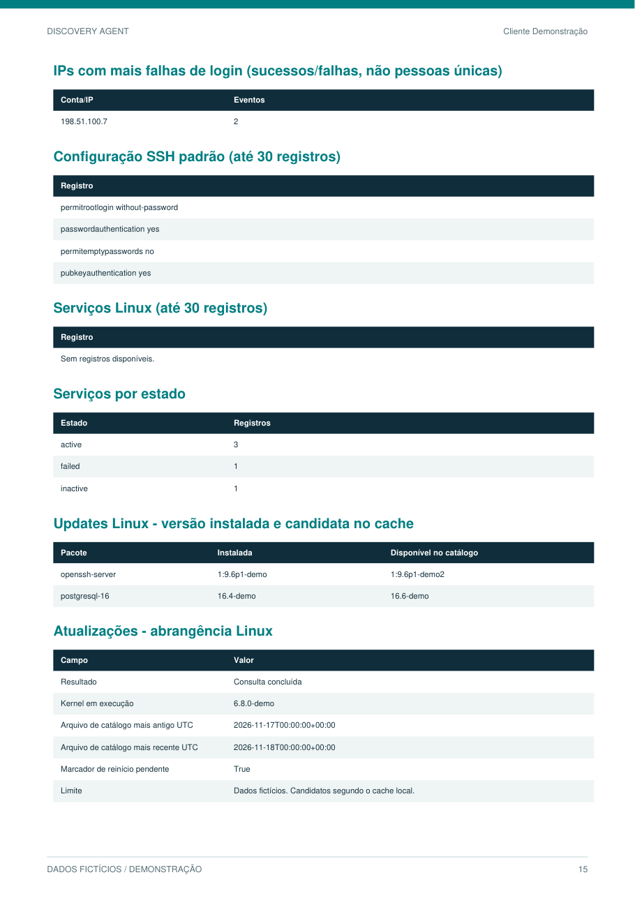
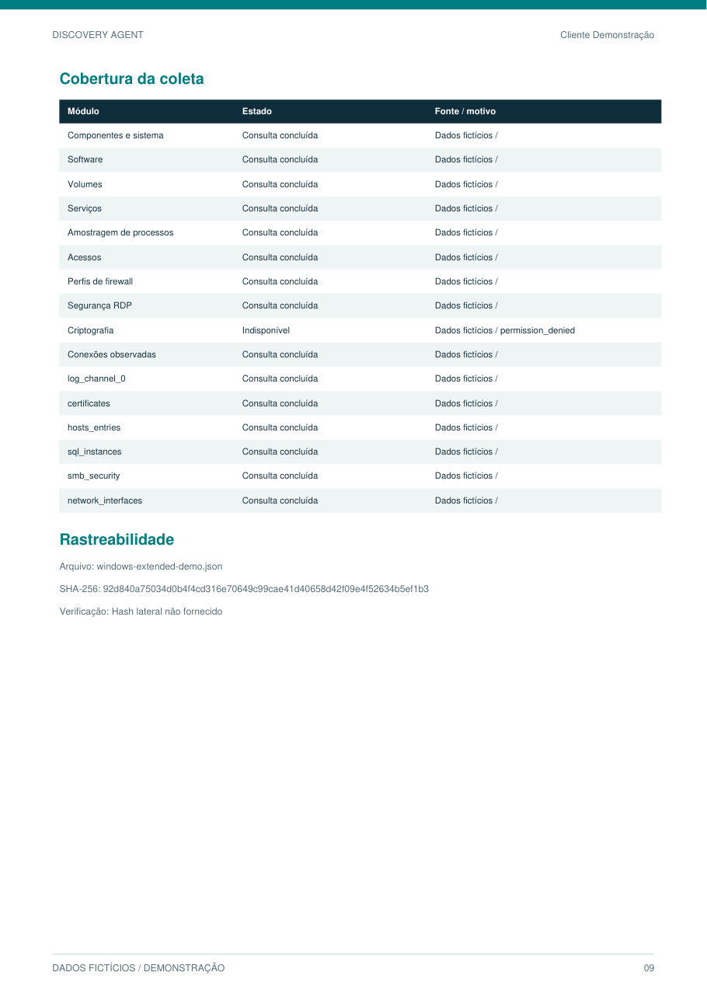

# Discovery Agent

**Server discovery for migration planning** — know the environment, plan the next step.

[English](README.md) · [Português](README.pt-BR.md)

A read-only discovery tool for Windows and Linux servers. Lightweight collectors run on each host, export a compressed, hash-verified JSON file, and an offline analysis station turns one or many collections into an executive + technical report (HTML and PDF) for migration, consolidation and security planning.



> **Portfolio of Gustavo Souza.** **About the images:** they are pages of the real PDF generated by the tool from the **fictitious demo collections** shipped with the project (`DEMO-WIN-APP01`, `DEMO-LNX-DB01`, documentation IP ranges). No client data is shown. Source code is kept private.

## The problem

Before migrating or taking over a client's environment you need to know what is really running: software, services, accounts, open connections, who logs in and from where, how busy each server is, what is pending update. Asking people gives incomplete answers; installing a full monitoring stack takes too long. The challenge is to collect evidence quickly, **without changing the servers**, and present it in a way that separates facts from gaps.

## At a glance

| Area | What it delivers |
|---|---|
| **Identity & capacity** | OS, version/build, domain, CPU, RAM, vendor/model, uptime, last boot. |
| **Storage** | Disks, volumes, filesystem, size and free space. |
| **Software & operation** | Installed software, services and run-as accounts, scheduled tasks, patches, pending updates (Windows + apt/dnf/yum). |
| **Accounts & access** | Local accounts and administrators; logon successes/failures in 5/7/30-day windows, origin IPs, last login per account (Security log / journald, sshd). |
| **Network** | Interfaces, observed TCP/UDP connections with owning process, SMB shares, firewall profiles. |
| **Security checks** | RDP/NLA, Defender, BitLocker (no recovery keys), SSH configuration, audit policy and log retention — local checks, not a CIS score. |
| **Consumption** | CPU and memory per process sampled over a configurable window. |
| **Report** | Multi-host HTML/PDF: executive view, per-server indicators, technical reading with evidence and next step, full inventory, collection coverage and SHA-256 traceability. |

<table><tr><td width="33%"><br><sub>Executive view</sub></td><td width="33%"><br><sub>Access & consumption</sub></td><td width="33%"><br><sub>Technical reading & actions</sub></td></tr><tr><td width="33%"><br><sub>Linux server</sub></td><td width="33%"><br><sub>Updates & SSH</sub></td><td width="33%"><br><sub>Coverage & traceability</sub></td></tr></table>

## Design principles

- **Read-only by design.** Collectors only create their own output folder. They do not enable auditing, install services, change firewall rules, send data to third parties or probe public ports. Cloud metadata is opt-in and never exports credentials or user-data.
- **No dependencies on the servers.** Windows uses PowerShell 5.1+; Linux uses bash + Python 3 standard library. ReportLab is needed only on the analysis station, for the PDF.
- **Evidence, not opinions.** Every finding cites its source. Missing logs, inventory or history appear as **gaps**, never as approval. A completed query does not mean a secure environment.
- **Traceable output.** Each collection is a `.json.gz` with a `.sha256` sidecar, restricted to the running identity and SYSTEM/root; the report records the hash of every input.
- **Time-bounded.** Every query has a timeout; sampling is capped at one hour per run.

## Architecture

```
 Windows server                 Linux server
 Collect-Discovery.ps1          collect-discovery.sh → linux.py
        │                               │
        └──── HOST_date.json.gz + .sha256 (offline transfer) ────┐
                                                                 ▼
                                   Analysis station (Python 3.9+)
                     analyze.py → insights.py → report.py (HTML/JSON)
                                         └→ pdf_design.py (ReportLab PDF)
         optional: series.py (repeated collections) · exposure.py (operator-chosen TCP probe)
                   noc_history.py (hourly trends from an existing Zabbix API)
```

## Quality

- 49 automated tests: analysis, insights, PDF layout and text, version consistency, CLI behavior and absence of legacy brand.
- GitHub Actions CI on every push: Python 3.9 and 3.12, ShellCheck, and PowerShell 5.1 + 7 on a Windows runner (parser, section contract and synthetic fixtures).
- Linux collector validated end-to-end on a disposable VM; the Windows collector is validated by parser and fixtures, with a native pilot planned.

## Stack

PowerShell · Bash · Python (standard library) · ReportLab · GitHub Actions
