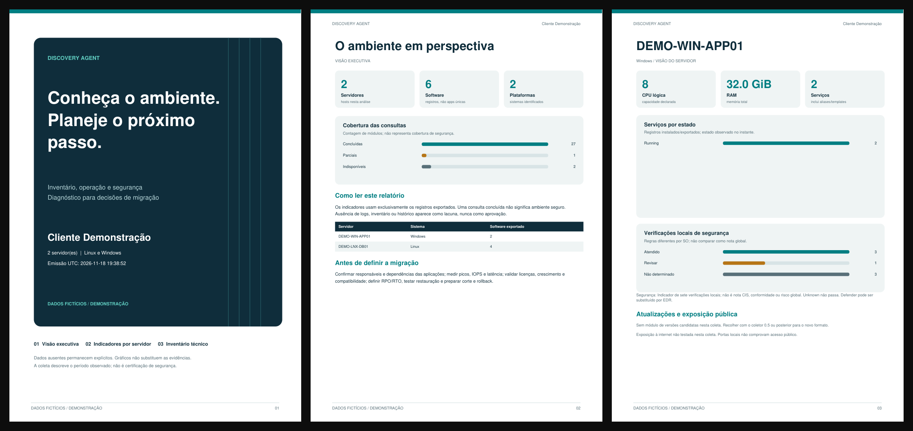
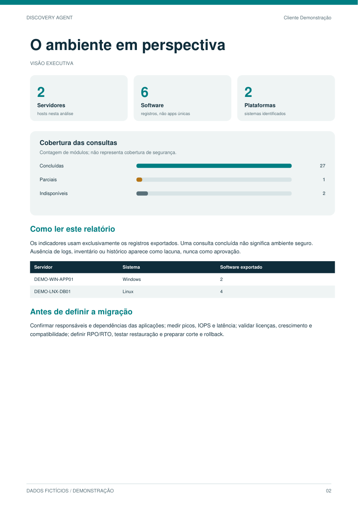
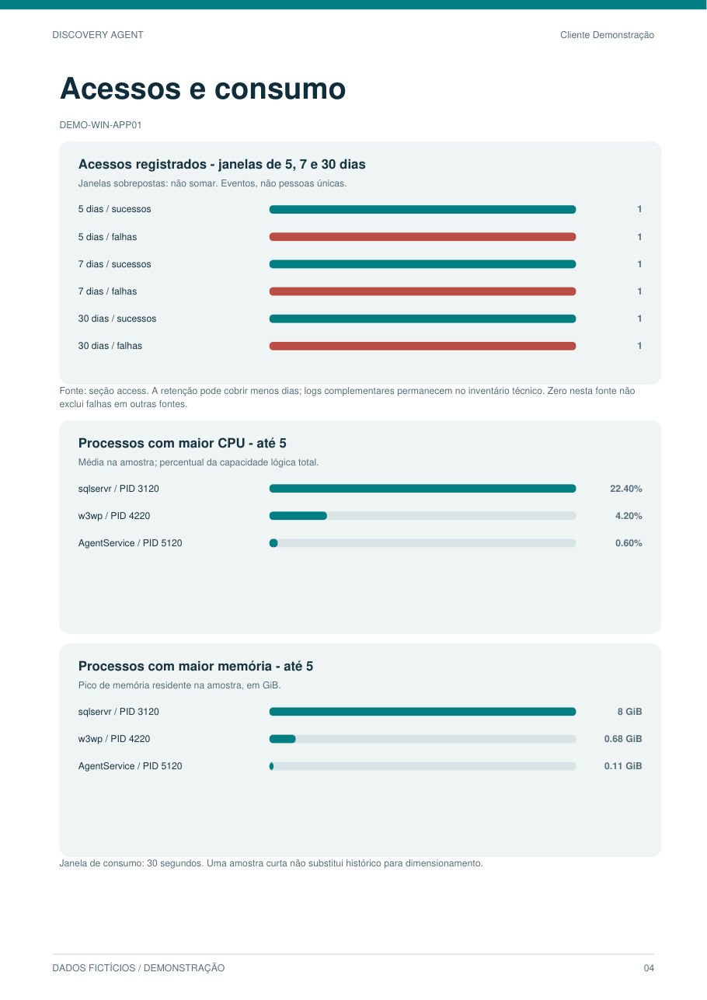
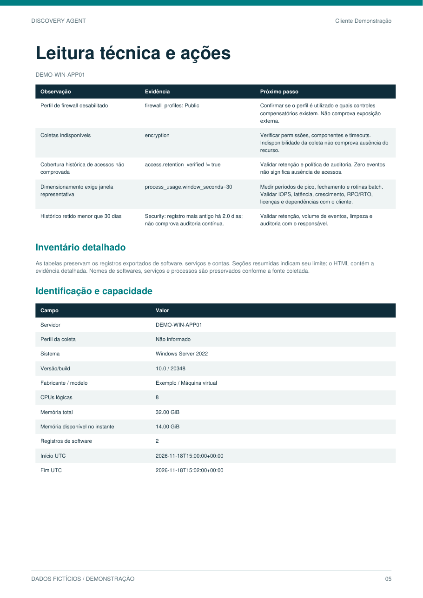
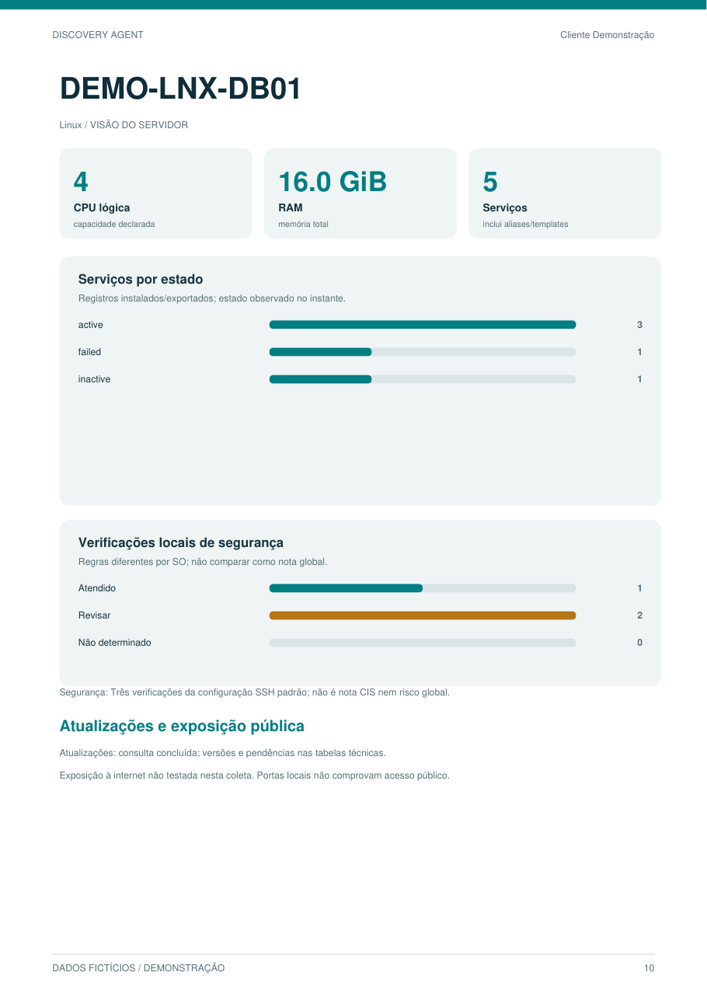
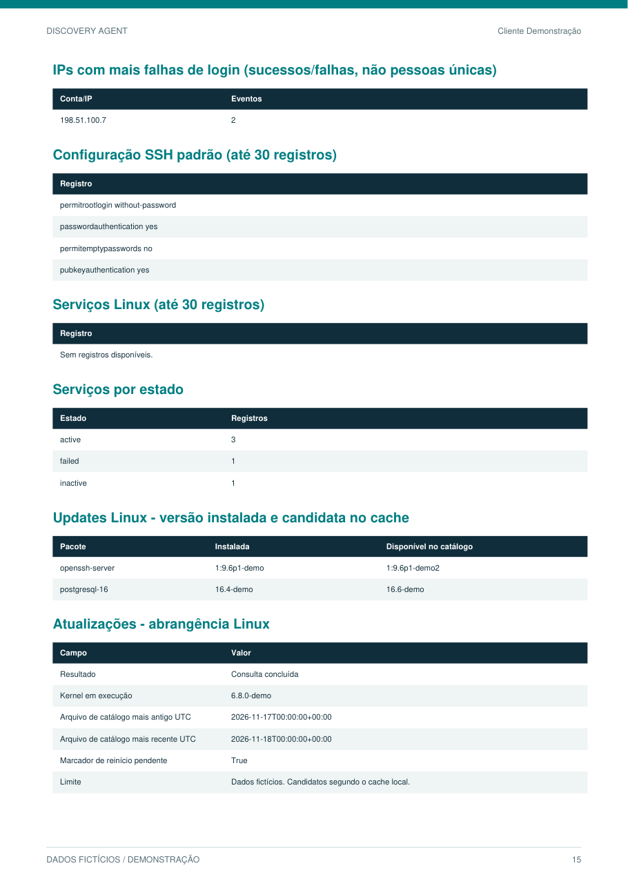
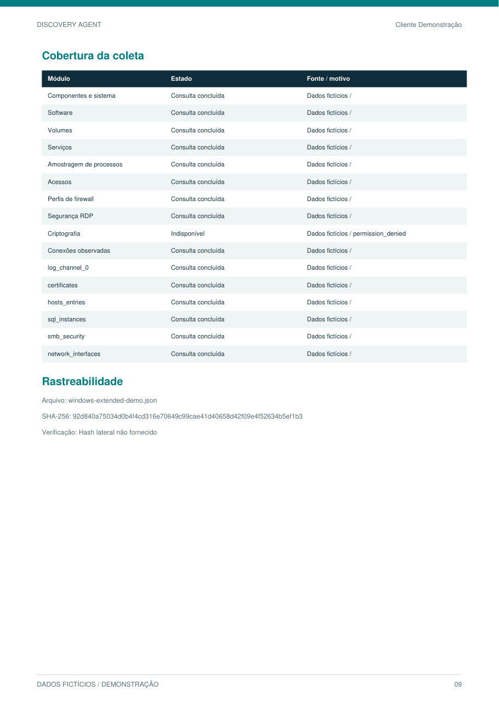

# Discovery Agent

**Descoberta de servidores para planejar migrações** — conheça o ambiente, planeje o próximo passo.

[English](README.md) · [Português](README.pt-BR.md)

Ferramenta de descoberta somente leitura para servidores Windows e Linux. Coletores leves rodam em cada servidor e exportam um JSON comprimido com hash. Depois, numa estação de análise offline, uma ou várias coletas viram um relatório executivo e técnico (HTML e PDF) para planejar migração, consolidação e segurança.



> **Portfólio de Gustavo Souza.** **Sobre as imagens:** são páginas do PDF real gerado pela ferramenta a partir das **coletas fictícias de demonstração** que acompanham o projeto (`DEMO-WIN-APP01`, `DEMO-LNX-DB01`, faixas de IP de documentação). Nenhum dado de cliente aparece. O código-fonte é privado.

## O problema

Antes de migrar ou assumir o ambiente de um cliente, é preciso saber o que realmente roda: softwares, serviços, contas, conexões abertas, quem acessa e de onde, quanto cada servidor consome, o que está com atualização pendente. Perguntar às pessoas dá respostas incompletas; instalar uma plataforma de monitoramento completa demora. O desafio é reunir evidências rápido, **sem alterar os servidores**, e apresentá-las separando fatos de lacunas.

## Em resumo

| Área | O que entrega |
|---|---|
| **Identidade e capacidade** | Sistema, versão/build, domínio, CPU, RAM, fabricante/modelo, uptime, último boot. |
| **Armazenamento** | Discos, volumes, formato, tamanho e espaço livre. |
| **Software e operação** | Softwares instalados, serviços e contas de execução, tarefas agendadas, patches, atualizações pendentes (Windows + apt/dnf/yum). |
| **Contas e acessos** | Contas locais e administradores; sucessos/falhas de logon em janelas de 5/7/30 dias, IPs de origem, último login por conta (log Security / journald, sshd). |
| **Rede** | Interfaces, conexões TCP/UDP observadas com o processo dono, compartilhamentos SMB, perfis de firewall. |
| **Verificações de segurança** | RDP/NLA, Defender, BitLocker (sem chaves de recuperação), configuração SSH, auditoria e retenção de logs — verificações locais, não nota CIS. |
| **Consumo** | CPU e memória por processo, amostrados numa janela configurável. |
| **Relatório** | HTML/PDF com vários servidores: visão executiva, indicadores por servidor, leitura técnica com evidência e próximo passo, inventário completo, cobertura da coleta e rastreabilidade SHA-256. |

<table><tr><td width="33%"><br><sub>Visão executiva</sub></td><td width="33%"><br><sub>Acessos e consumo</sub></td><td width="33%"><br><sub>Leitura técnica e ações</sub></td></tr><tr><td width="33%"><br><sub>Servidor Linux</sub></td><td width="33%"><br><sub>Atualizações e SSH</sub></td><td width="33%"><br><sub>Cobertura e rastreabilidade</sub></td></tr></table>

## Princípios

- **Somente leitura.** Os coletores só criam a própria pasta de saída. Não habilitam auditoria, não instalam serviços, não mexem no firewall, não enviam dados a terceiros e não testam portas públicas. Metadados de nuvem são opcionais e nunca exportam credenciais ou user-data.
- **Nada a instalar nos servidores.** Windows usa PowerShell 5.1+; Linux usa bash + biblioteca padrão do Python 3. O ReportLab só é necessário na estação de análise, para o PDF.
- **Evidência, não opinião.** Cada observação cita a fonte. Falta de logs, inventário ou histórico aparece como **lacuna**, nunca como aprovação. Consulta concluída não significa ambiente seguro.
- **Saída rastreável.** Cada coleta é um `.json.gz` com `.sha256`, acessível só pela identidade executora e SYSTEM/root; o relatório registra o hash de cada entrada.
- **Tempo limitado.** Toda consulta tem timeout; a amostragem é limitada a uma hora por execução.

## Arquitetura

```
 Servidor Windows               Servidor Linux
 Collect-Discovery.ps1          collect-discovery.sh → linux.py
        │                               │
        └──── HOST_data.json.gz + .sha256 (transferência offline) ────┐
                                                                      ▼
                                   Estação de análise (Python 3.9+)
                     analyze.py → insights.py → report.py (HTML/JSON)
                                         └→ pdf_design.py (PDF ReportLab)
      opcionais: series.py (coletas repetidas) · exposure.py (teste TCP escolhido pelo operador)
                 noc_history.py (tendências horárias de uma API Zabbix existente)
```

## Qualidade

- 49 testes automáticos: análise, observações, layout e texto do PDF, versão única, comportamento das linhas de comando e ausência de marca antiga.
- CI no GitHub Actions a cada envio: Python 3.9 e 3.12, ShellCheck, e PowerShell 5.1 + 7 num runner Windows (parser, contrato das seções e fixtures sintéticas).
- Coletor Linux validado de ponta a ponta em VM descartável; coletor Windows validado por parser e fixtures, com piloto nativo planejado.

## Tecnologias

PowerShell · Bash · Python (biblioteca padrão) · ReportLab · GitHub Actions
